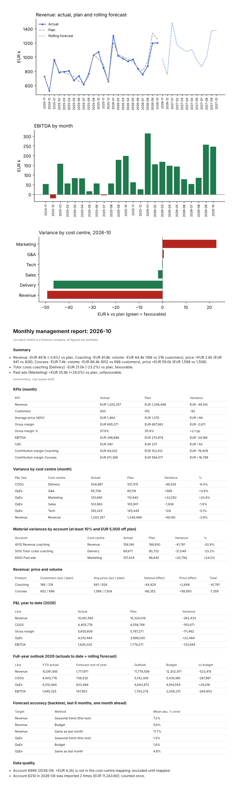

# fpa-autopilot

Automated monthly FP&A reporting in Python and SQL: plan-vs-actual by cost centre, a KPI tree with one definition per metric, a price/volume split of revenue, a rolling forecast with a full-year outlook, and variance commentary that an LLM can draft but never invent numbers for.

One command turns raw controlling exports (chart of accounts, GL actuals, budget, customer drivers) into a management report and a dashboard:

```bash
pip install -r requirements.txt
python -m fpa generate                        # synthetic data set (fictional company)
python -m fpa report --month 2026-10          # reports/report-2026-10.md + dashboard-2026-10.html
python -m fpa report --month 2026-10 --llm    # LLM-drafted commentary, fact-checked (needs OPENAI_API_KEY)
python -m fpa kpis                            # print the KPI definitions
```

All data is **synthetic**. "Lernwerk GmbH" is a fictional online-education company with two products (courses and coaching), six cost centres and 24 months of actuals.



See the full example output in [`examples/report-2026-10.md`](examples/report-2026-10.md).

## What the October 2026 report finds

The data has a story planted in October 2026, and the report finds it without being told where to look:

- **Revenue −EUR 49.1k (−3.9%) vs plan.** The price/volume split shows why. Courses lost EUR 66.4k on volume (652 vs 696 customers), but a price increase recovered EUR 59.0k. Coaching fell EUR 41.8k, almost all of it volume (168 vs 216 customers).
- **Paid ads +EUR 20.8k (+24.0%) over plan**, an autumn campaign overspend. Combined with fewer customers, this pushed CAC from EUR 237 to EUR 290.
- **Full-year outlook:** year-to-date actuals plus the rolling forecast put 2026 revenue **EUR 523k below budget**. The plan assumed faster growth than the business is delivering.
- **Data quality:** one booking on an account missing from the cost-centre mapping (reported, not silently dropped) and one duplicate import (counted once).

## How it works

| Step | File | What it does |
|---|---|---|
| Load and clean | `fpa/db.py`, `sql/views.sql` | Loads the CSV exports into SQLite. SQL views map accounts to P&L lines and cost centres, collapse duplicate imports, list unmapped accounts, and build plan-vs-actual. |
| KPIs | `fpa/kpis.py` | One definition per KPI (revenue, AOV, gross margin, contribution margin, EBITDA, CAC). A reconciliation check confirms the KPI tree adds up every month: customers × price = revenue, Σ contribution margins = gross margin, gross margin − OpEx = EBITDA. |
| Variance | `fpa/variance.py` | Variances by cost centre and account, for the month and year to date. Materiality = at least 10% **and** EUR 5,000 off plan, tested per account, because a cost centre can look fine while one account inside it is far off. Revenue variance split into volume and price effects, which add up exactly. |
| Forecast | `fpa/forecast.py` | Rolling 12-month forecast per account: same month last year × recent year-over-year growth. Gives a full-year outlook (YTD actuals + forecast). A backtest compares it with the budget and with "same as last month". |
| Commentary | `fpa/commentary.py` | A rule-based draft that always works. Optionally an LLM draft. **Every number in the LLM text is checked against the computed variances; one unsupported number and the LLM draft is rejected** in favour of the rule-based one. |
| Report | `fpa/report.py` | Markdown management report and a self-contained HTML dashboard with three charts. |

## Forecast accuracy, reported honestly

One-month-ahead backtest over the last 6 months (mean absolute % error):

| Target | Seasonal trend (this tool) | Budget | Same as last month |
|---|---:|---:|---:|
| Revenue | 7.2% | 5.8% | 11.7% |
| OpEx | 1.5% | 1.8% | 4.8% |

The simple method clearly beats "same as last month" and does better than the budget on OpEx. On revenue, the budget is still closer one month ahead, because month-to-month customer numbers are noisy. Where the forecast earns its keep is the **full-year outlook**: it reflects the growth the business is actually delivering, while the budget still assumes the original plan. Next steps would be driver-based revenue forecasting (forecast customers and price separately) and a confidence band.

## Design choices

- **SQL for the mapping, Python for the analysis.** The account-to-cost-centre mapping and data-quality rules live in SQL views that a controller can read and change. The analysis lives in tested Python.
- **Bad data is reported, never silently dropped.** Unmapped accounts and duplicates appear in the report's data-quality section with month and amount.
- **LLMs write, code checks.** Commentary is the part of month-end reporting where an LLM saves the most time, and the part where an invented number does the most damage. The fact check makes the LLM optional and safe.
- **Standard library + pandas only.** The LLM call uses `urllib` against any OpenAI-compatible API, so there's no vendor SDK.

## Tests

```bash
python -m pytest -q    # 17 tests
```

Tests cover SQL totals against the raw data, detection of unmapped and duplicate bookings, the KPI tree reconciliation for every month, price/volume effects adding up, materiality rules, the forecast on a known series, the LLM fact check (accepts correct numbers, rejects an invented one) and the end-to-end report. CI runs them on every push.
